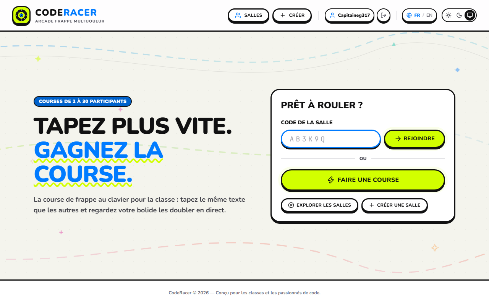
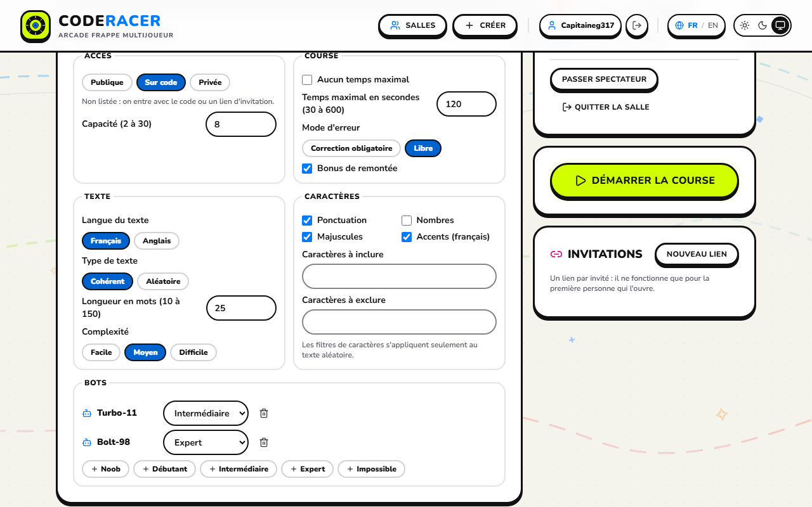
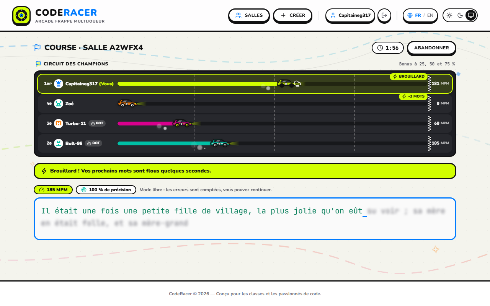
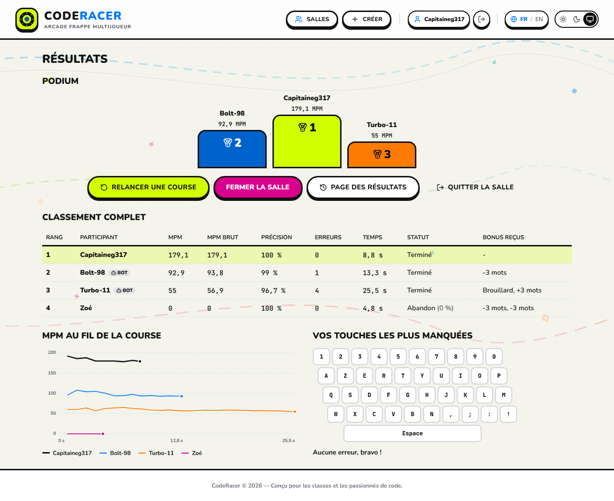
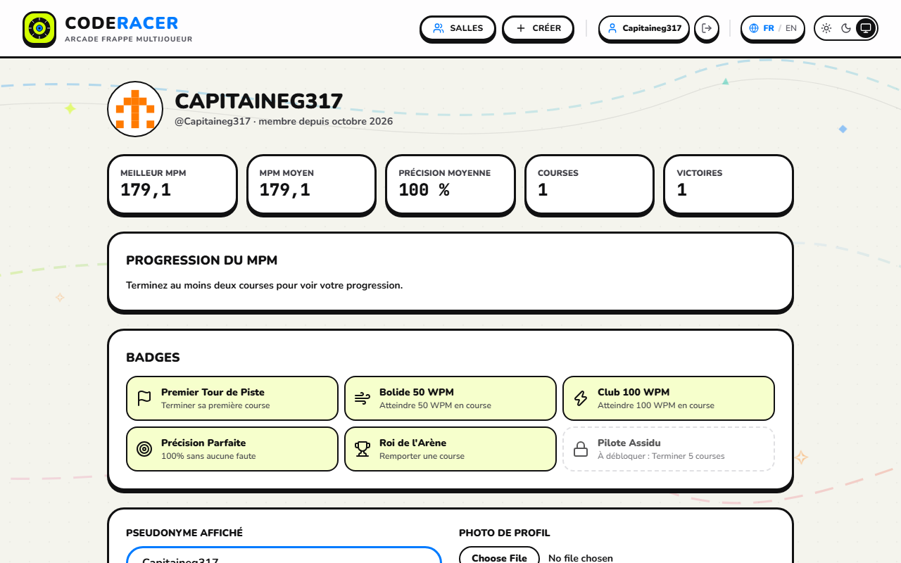
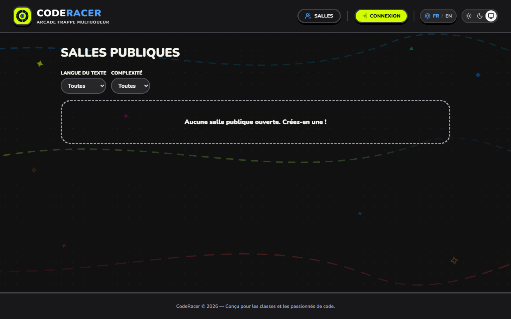

# CodeRacer

Course de frappe au clavier multijoueur en temps réel, pensée pour la classe (12–17 ans). Les joueurs se retrouvent dans une salle identifiée par un code de 6 caractères, tapent le même texte et voient la progression de chacun en direct sur une piste. Des bots de cinq niveaux peuvent compléter la salle, et des bonus de remontée gardent la course serrée jusqu'au bout.

> Le nom et le logo sont provisoires : voir `docs/DEMARCHE-CREATIVE.md`.

| Accueil                                 | Salle d'attente                               |
| --------------------------------------- | --------------------------------------------- |
|         |      |
| **Course (bonus « brouillard » actif)** | **Résultats**                                 |
|          |          |
| **Profil et historique**                | **Explorateur, thème sombre**                 |
|       |  |

## Fonctionnalités

- Connexion Discord, GitHub ou nom d'utilisateur / mot de passe ; jeu en invité sous pseudonyme.
- Salles publiques, sur code ou privées, liens d'invitation à usage unique, expulsion, passation d'hôte, une salle à la fois.
- Explorateur des salles publiques en direct, partie rapide, jonction par code depuis l'accueil.
- Configuration complète : temps maximal, langue, texte cohérent (corpus du domaine public) ou aléatoire, longueur, complexité, ponctuation, nombres, majuscules, accents, caractères à inclure ou exclure, mode d'erreur, bonus, bots.
- Course autoritaire côté serveur : décompte synchronisé, piste mise à jour 5 fois par seconde, anti-triche, reconnexion sous 30 s.
- Résultats : podium, tableau complet, graphique du MPM de tous les participants, carte de chaleur des touches manquées, record personnel.
- Profil avec statistiques, graphique de progression, badges et historique paginé ; photo de profil et pseudonyme modifiables.
- Français et anglais, thèmes clair / sombre / système, utilisable dès 360 px.

## Technologies

| Domaine          | Choix                                                                                   |
| ---------------- | --------------------------------------------------------------------------------------- |
| Application      | Next.js 16 (App Router, Server Components, Server Actions), React 19, TypeScript strict |
| Temps réel       | WebSocket (`ws`) dans un serveur Node personnalisé (`server.ts`)                        |
| Données          | PostgreSQL, Prisma 7 (`@prisma/adapter-pg`), migrations versionnées                     |
| Authentification | Auth.js v5 (sessions JWT), bcrypt                                                       |
| Validation       | Zod (actions, messages WebSocket, configuration)                                        |
| Style            | Tailwind CSS v4, Lucide                                                                 |
| Images           | sharp (redimensionnement des avatars)                                                   |
| Tests            | `bun test` (unitaires), Playwright (bout en bout)                                       |
| Outils           | Bun, ESLint, Prettier, GitHub Actions, Docker, Fly.io                                   |

L'architecture (modèle de données, machine à états, flux des messages, ADR) est décrite dans [`docs/ARCHITECTURE.md`](docs/ARCHITECTURE.md), et la matrice des exigences dans [`docs/EXIGENCES.md`](docs/EXIGENCES.md).

## Installation locale

Prérequis : [Bun](https://bun.sh) 1.4, Node.js 22 et Docker.

```bash
bun install
cp .env.example .env          # puis renseigner AUTH_SECRET (openssl rand -base64 32)
docker compose up -d          # PostgreSQL 17 sur le port 5432
bun run db:deploy             # applique les migrations
bun run db:seed               # corpus, badges, comptes et historique de démonstration
bun run dev                   # http://localhost:3000
```

`bun run dev` lance `server.ts` (Next.js en développement + WebSocket). Les modifications de l'interface se rechargent à chaud ; une modification du serveur temps réel (`src/server/realtime/`) demande de relancer la commande.

### Compte de démonstration

| Nom d'utilisateur | Mot de passe |
| ----------------- | ------------ |
| `demo`            | `demo1234`   |

Trois autres comptes sont créés avec le même mot de passe : `pixel_pilot`, `nitro_nina`, `turbo_tortue`.

## Variables d'environnement

Toutes sont documentées dans [`.env.example`](.env.example).

| Variable                                 | Rôle                                                                                         |
| ---------------------------------------- | -------------------------------------------------------------------------------------------- |
| `DATABASE_URL`                           | Connexion PostgreSQL                                                                         |
| `AUTH_SECRET`                            | Signe les sessions, le cookie invité et les tickets temps réel                               |
| `AUTH_DISCORD_ID`, `AUTH_DISCORD_SECRET` | Application OAuth Discord (callback : `/api/auth/callback/discord`)                          |
| `AUTH_GITHUB_ID`, `AUTH_GITHUB_SECRET`   | Application OAuth GitHub (callback : `/api/auth/callback/github`)                            |
| `PORT`                                   | Port HTTP (3000 par défaut)                                                                  |
| `TRUST_PROXY`                            | `true` derrière un proxy pour lire l'IP du client (limite de tentatives, liens d'invitation) |
| `ROOM_CODE_RATE_LIMIT`                   | Tentatives de code par IP et par minute (10 par défaut)                                      |

## Tests et vérifications

```bash
bun run typecheck      # tsc --noEmit
bun run lint           # ESLint
bun run format:check   # Prettier
bun test               # tests unitaires (tests/)
bun run build          # build de production
bun run test:e2e       # Playwright (e2e/) : nécessite la base migrée et la build
```

Les tests de bout en bout démarrent eux-mêmes le serveur de production sur le port 3100 et créent leurs propres comptes. La première fois : `bunx playwright install chromium`. GitHub Actions exécute tout cela à chaque push (`.github/workflows/ci.yml`).

## Déploiement (Fly.io)

```bash
fly launch --no-deploy                      # une seule fois, garde fly.toml
fly postgres create && fly postgres attach  # ou toute base PostgreSQL
fly secrets set AUTH_SECRET=... AUTH_DISCORD_ID=... AUTH_DISCORD_SECRET=... \
  AUTH_GITHUB_ID=... AUTH_GITHUB_SECRET=...
fly deploy                                  # migrations appliquées en release_command
fly ssh console -C "node --import tsx prisma/seed.ts"   # données de démonstration
```

L'état des courses est en mémoire : l'application doit tourner sur **une seule machine** (voir l'ADR). `fly.toml` la garde allumée en permanence.

## Documentation

- [`docs/EXIGENCES.md`](docs/EXIGENCES.md) : matrice de traçabilité et choix documentés
- [`docs/ARCHITECTURE.md`](docs/ARCHITECTURE.md) : architecture, modèle de données, machine à états, flux temps réel, ADR
- [`docs/DEMARCHE-CREATIVE.md`](docs/DEMARCHE-CREATIVE.md) : nom, logo, direction artistique
- [`docs/IA.md`](docs/IA.md) : utilisation des agents IA
