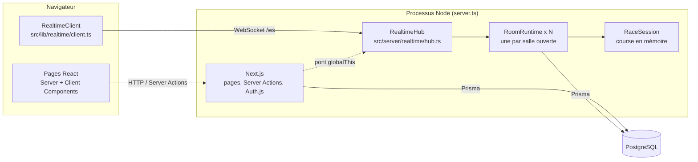
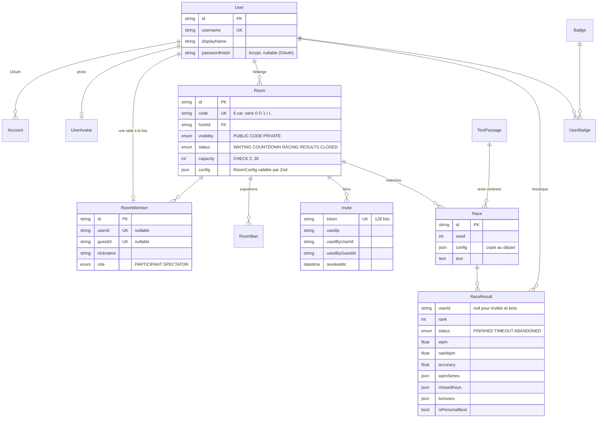
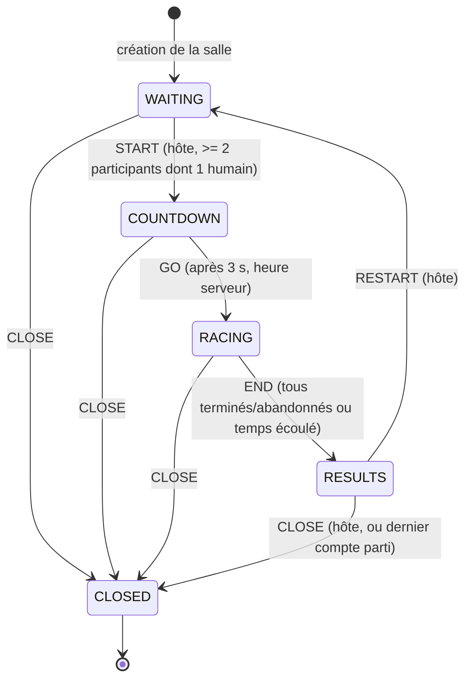
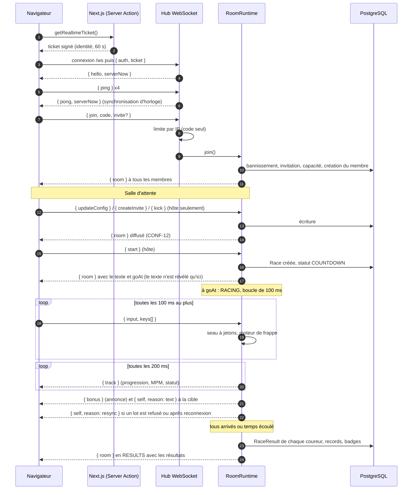

# Architecture

## Vue d'ensemble

- **Un seul processus** : `server.ts` démarre Next.js et un serveur WebSocket (`ws`) sur le même port HTTP. HTTPS est terminé par le proxy de Fly.io.
- **Next.js** sert les pages, les Server Actions (création de salle, profil, avatar, langue, invité) et Auth.js.
- **Le hub temps réel** authentifie les sockets, applique la limite de tentatives par IP et route les messages vers la `RoomRuntime` de la salle.
- **La base de données est la source de vérité** pour les membres, l'hôte, l'état et la configuration des salles ; la `RoomRuntime` en garde une copie et pilote la course. La progression d'une course reste en mémoire et n'est écrite qu'à la fin.
- **Pont** : les Server Actions sont compilées par Next.js dans leur propre copie des modules. Elles joignent le hub par un objet posé sur `globalThis` (`src/server/realtime/bridge.ts`), par exemple pour retirer quelqu'un de sa salle actuelle avant d'en créer une nouvelle.

### Organisation du code

| Dossier                | Rôle                                                                                                                  |
| ---------------------- | --------------------------------------------------------------------------------------------------------------------- |
| `src/lib/game/`        | Logique pure et testée : configuration, frappe, bots, bonus, textes, machine à états, classement, aléatoire à graine. |
| `src/lib/realtime/`    | Protocole WebSocket (schémas Zod), client navigateur, réducteur d'état de salle.                                      |
| `src/server/realtime/` | Hub, runtime de salle, session de course, persistance des résultats.                                                  |
| `src/server/actions/`  | Server Actions (validation Zod, réponse `{ success, ... }`).                                                          |
| `src/components/`      | Interface : `race/` (piste, zone de frappe), `room/`, `rooms/`, `results/`, `charts/`, `profile/`.                    |
| `prisma/`              | Schéma, migrations versionnées, seed et corpus.                                                                       |

## Modèle de données

Points notables :

- `RoomMember.userId` et `RoomMember.guestId` sont **uniques dans toute la table** : la base garantit qu'une personne n'est que dans une salle (SALLE-06). Une contrainte CHECK impose exactement une des deux identités.
- Les statistiques du profil sont **calculées** à partir de `RaceResult` (pas de table dénormalisée à garder synchronisée).
- Les invités n'ont pas de ligne `User` : leur identité est l'identifiant du cookie signé.

## Machine à états d'une course (COURSE-01)

Correspondance avec l'énoncé : EN_ATTENTE = `WAITING`, DÉCOMPTE = `COUNTDOWN`, EN_COURSE = `RACING`, RÉSULTATS = `RESULTS`, FERMÉE = `CLOSED`. Les transitions sont dans `src/lib/game/state-machine.ts` ; toute autre transition est refusée. On ne peut entrer que dans `WAITING` ou `RESULTS` (SALLE-09).

Chaque coureur a aussi son propre état : `RACING`, puis `FINISHED`, `TIMEOUT` ou `ABANDONED` (`src/lib/game/ranking.ts`).

## Flux des messages temps réel

Tous les messages client sont validés par `clientMessageSchema` (`src/lib/realtime/protocol.ts`) avant traitement.

Déconnexion : quand le dernier onglet d'un membre se ferme, un minuteur de 30 s démarre. Une reconnexion l'annule et renvoie l'état (`room` puis `self`). À l'expiration, le membre abandonne la course et quitte la salle ; si c'était l'hôte, le rôle passe au compte présent depuis le plus longtemps, sinon la salle ferme.

Au démarrage du serveur, toutes les salles ouvertes sont rechargées : une course interrompue par le redémarrage revient en attente et les absents sont retirés après 30 s.

## ADR 1 — Technologie temps réel

**Statut** : accepté.

**Contexte.** Il faut diffuser la progression d'au plus 30 coureurs au moins 4 fois par seconde (COURSE-05), recevoir les frappes de chaque joueur (au plus 10 messages/s, PERF-02), avec un serveur autoritaire (COURSE-06), sans service payant (TECH-08), sur un petit VPS.

**Options.**

1. **WebSocket auto-hébergé (`ws`) dans un serveur Node personnalisé.** Bidirectionnel, aucune dépendance externe, état en mémoire à côté de la logique de jeu. Inconvénients : serveur personnalisé (pas de sortie `standalone` de Next.js), une seule instance.
2. **Socket.IO.** Mêmes avantages, plus reconnexion et salles intégrées, mais une bibliothèque plus lourde côté client et un protocole propriétaire ; nos besoins (une salle par socket, reconnexion simple) se codent en quelques dizaines de lignes.
3. **Server-Sent Events + Server Actions.** Pas de serveur personnalisé, mais un aller-retour HTTP par lot de frappes et des connexions SSE à garder en mémoire de toute façon ; la validation des frappes devient plus coûteuse.
4. **Service géré (Pusher, Ably, Supabase Realtime).** Rien à héberger, mais quotas gratuits limités, et le serveur ne serait plus l'autorité des frappes sans un aller-retour supplémentaire.
5. **MQTT.** Adapté à l'IoT ; demande un courtier séparé, sans bénéfice ici.

**Décision.** Option 1 : `ws` sur le même port que Next.js (`server.ts`). Les messages sont du JSON validé par Zod. L'authentification passe par un ticket HMAC de 60 s émis par une Server Action, ce qui évite de décoder les cookies Auth.js dans le serveur WebSocket.

**Conséquences.**

- Une seule machine (état en mémoire) : `fly.toml` garde une machine toujours allumée. Monter en charge demanderait un état partagé (Redis) et une affinité par salle.
- L'image Docker contient l'application complète et lance `server.ts` avec `tsx`.
- Les membres, l'hôte et la configuration sont persistés à chaque changement, si bien qu'un redémarrage ne perd que la course en cours.

## ADR 2 — Gestion des bots

**Statut** : accepté.

**Contexte.** Cinq niveaux (BOT-01), une vitesse variable (BOT-02), des erreurs qui ralentissent et respectent le mode d'erreur (BOT-03), soumis aux bonus (BOT-04), et déterministes à partir d'une graine pour les tests (BOT-05).

**Options.**

1. **Animation de la progression** (pourcentage qui augmente selon une vitesse). Simple, mais les statistiques (MPM brut, précision, touches manquées) seraient inventées, et les bonus qui changent le texte demanderaient un traitement à part.
2. **Bot qui produit des frappes**, passées au même moteur que les humains. Les statistiques, le classement et les bonus suivent exactement les mêmes règles.
3. **Bots côté client.** Moins de charge serveur, mais le classement ne serait plus autoritaire et chaque client verrait une course différente.

**Décision.** Option 2, côté serveur. `src/lib/game/bots.ts` planifie chaque frappe à une heure absolue de la course :

- un MPM cible tiré une fois dans la plage du niveau ;
- par mot : facteur de difficulté (longueur, majuscules, symboles) × variation aléatoire 0,8–1,25 × « forme » qui dérive lentement, et 6 % d'hésitations ;
- par frappe : probabilité d'erreur du niveau ; en correction obligatoire, la mauvaise touche est refusée puis la bonne est tapée après un délai de réaction, en mode libre l'erreur reste avec un court trébuchement ;
- un facteur de calibration (0,76) compense ces ralentissements pour que le MPM net mesuré tombe dans la plage du niveau ;
- le brouillard ralentit le bot ×1,6 pendant 5 s.

Toute la variation vient d'un générateur à graine (mulberry32) initialisé avec `graine de course XOR hachage(id du bot)`. Comme les frappes sont planifiées à des heures absolues, le résultat ne dépend pas de la fréquence de la boucle serveur.

**Conséquences.** Les bots coûtent peu (quelques opérations par frappe dans la boucle de 100 ms) et sont testés unitairement (`tests/bots.test.ts`). Les valeurs mesurées sont dans `docs/EXIGENCES.md` (BOT-01).

## Règle des bonus de remontée (BONUS-01)

- Les points de contrôle sont atteints quand le **meneur** (plus grande progression) dépasse pour la première fois 25 %, 50 % et 75 % de son texte.
- À chaque point de contrôle, chaque coureur **encore en course** qui est **en retard** reçoit un bonus. En retard = dernier des coureurs encore en course, ou plus de 25 points de progression derrière le meneur. Le meneur n'est jamais en retard.
- Au plus **3 bonus** par coureur et par course.
- Le type est tiré avec le générateur de la course : **-3 mots** (retire les 3 derniers mots du texte du bénéficiaire, jamais le mot en cours), **+3 mots** (ajoute 3 mots au texte du meneur) ou **brouillard** (les mots après le mot en cours du meneur sont flous 5 s). Les bonus qui visent le meneur ne le touchent qu'une fois par point de contrôle et seulement s'il est encore en course ; sinon le bénéficiaire reçoit un -3 mots.
- Progression et MPM sont toujours calculés sur le texte propre à chaque coureur (BONUS-04).
