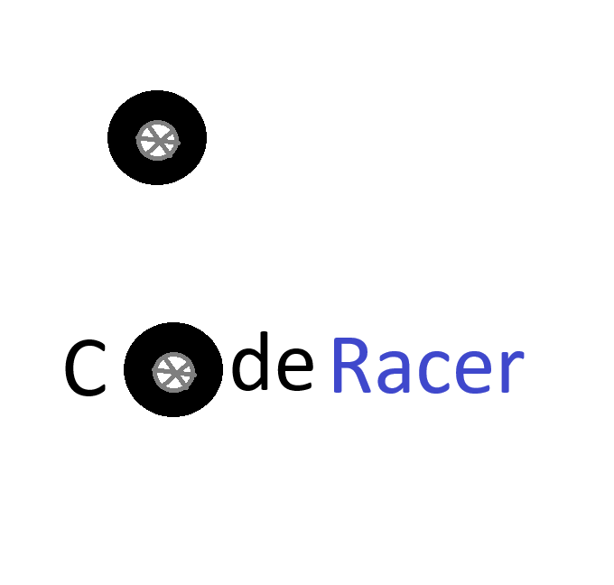
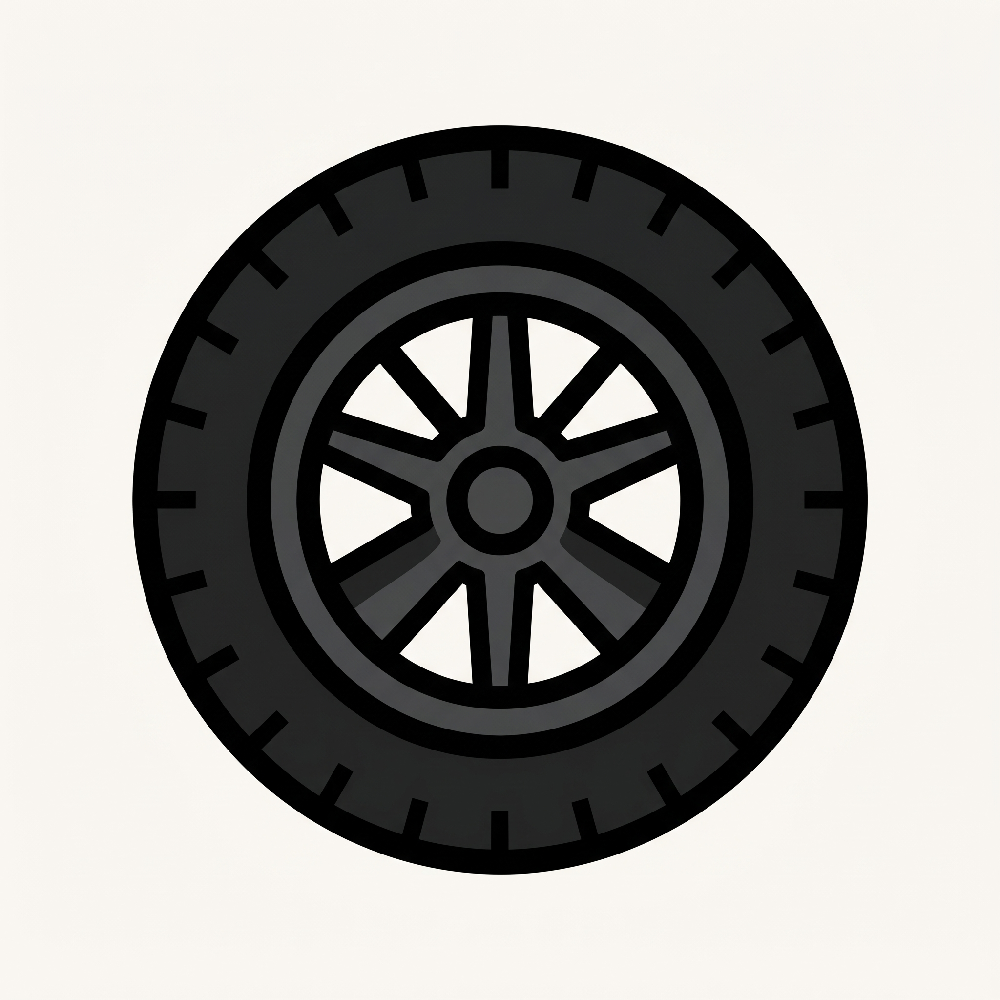
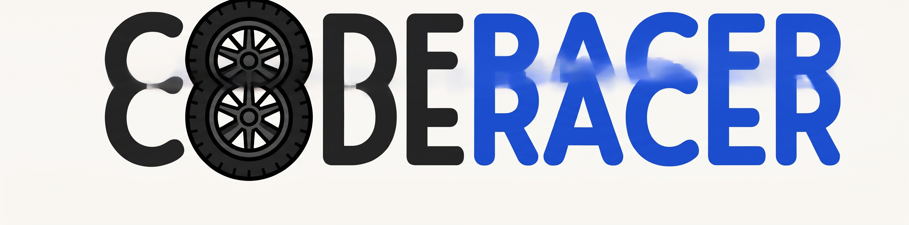
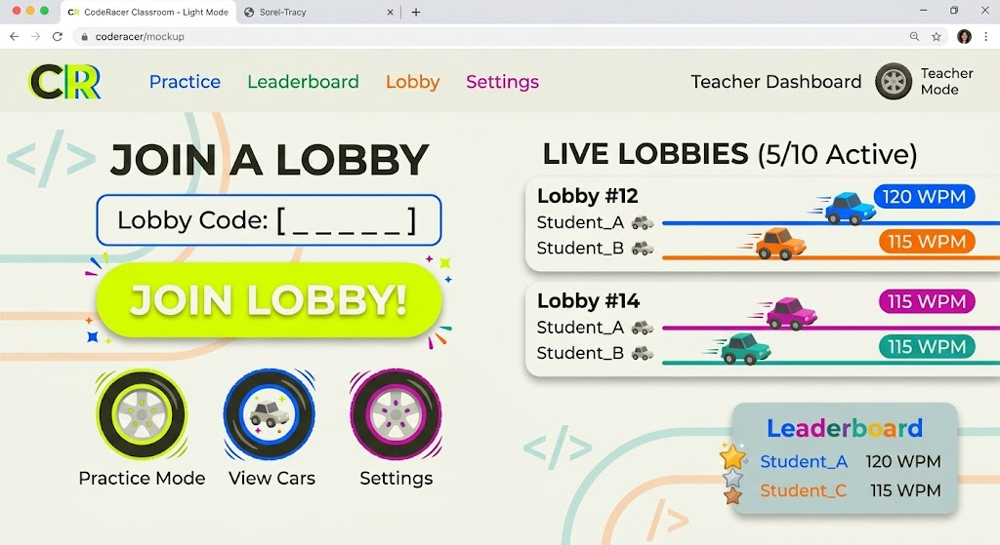
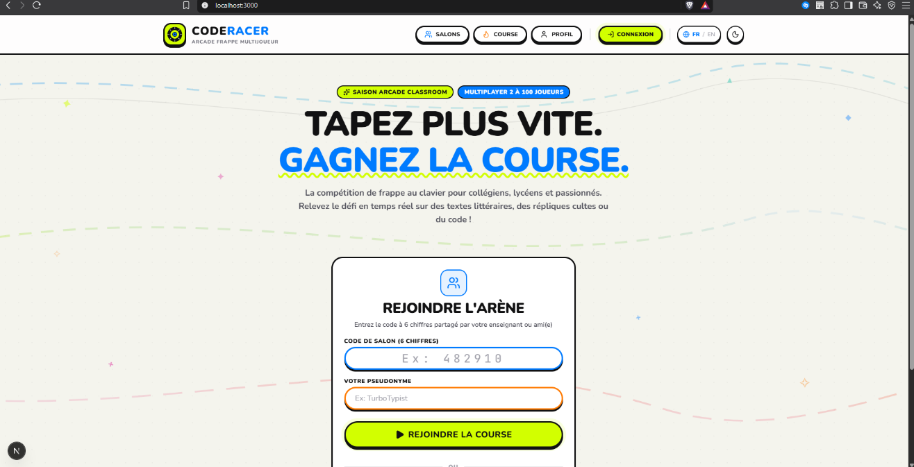

# Démarche créative

> Le nom et le logo viennent de l'étudiant, sans IA (DES-01, DES-02). La direction artistique reprend la démarche artistique remise au checkpoint 1 (7 octobre 2026), avant le développement des fonctionnalités. Les parties marquées « À compléter » restent à fournir par l'étudiant : rien n'y a été inventé.

## 1. Nom du site (DES-01)

Nom retenu : **CodeRacer**.

J'ai choisi le nom « CodeRacer », car une des listes de mots que le client voulait était « code ». De plus, l'application est destinée à une cohorte d'étudiants, et une des raisons principales de vouloir s'améliorer à l'écriture sur ordinateur est de coder ou de faire toutes sortes de tâches semblables à de la programmation. Même si l'application ne s'adresse pas spécifiquement à l'écriture de code, elle s'adresse à des cohortes de jeunes qui ont un intérêt pour le code. La personnalité du site tourne autour de la course, alors c'est « CodeRacer ».

**À compléter :**

- Autres noms envisagés (avec, pour chacun, pourquoi vous l'avez écarté) :
  1. …
  2. …
- Vérification d'originalité (recherches faites, résultats) : …

> Attention : un projet open source connu porte déjà le nom « Code Racer » (de WebDevCody). L'énoncé demande de vérifier que le nom n'est pas déjà utilisé par un produit connu ; la vérification ci-dessus doit expliquer pourquoi le nom reste acceptable, ou le nom doit changer.

## 2. Logo (DES-02)

Le logo est une **roue**. L'idée vient de la première tempête d'idées du checkpoint 1, qui notait déjà « des boutons ronds en forme de roues » à côté des petites voitures et de la ligne d'arrivée.

### Croquis

Le premier jet, dessiné dans Paint : la roue seule, puis la roue à la place du « o » de « Code », avec « Racer » en bleu.

### Version au propre

Générée avec Gemini à partir du croquis ci-dessus : l'idée et la composition viennent du croquis, Gemini en a fait une version plus nette. La roue seule sert de logo ; la version complète reprend l'idée du croquis, avec deux roues superposées qui forment le « o ».

| Roue                                               | Logo complet                                                   |
| -------------------------------------------------- | -------------------------------------------------------------- |
|  |  |

### Dans l'application

- **Barre de navigation** : le logo complet (`src/components/layout/BrandLogo.tsx`, image `src/assets/full-logo.png`). Ses lettres sont foncées : en thème sombre, il est posé sur une tuile blanc cassé pour rester lisible.
- **Favicon** : la roue seule, détourée en cercle, en `src/app/favicon.ico` (16, 32 et 48 px), `src/app/icon.png` (192 px) et `src/app/apple-icon.png` (180 px, sur le fond blanc cassé).

Les dessins ne sont pas modifiés : le fond est seulement rendu transparent (détourage en cercle pour la roue), puis l'image est redimensionnée.

## 3. Direction artistique (DES-03)

Thème : **« Arcade de classe vibrante »**. L'application fait courser des élèves de 12 à 17 ans dans un cadre scolaire : le site doit être vibrant, énergique et jeune, mais aussi clair et épuré. Le résultat : un canevas clair et lisible pour la lecture, entouré de couleurs d'arcade très saturées, de lignes de vitesse et de formes « tactiles » (bordures épaisses, ombres franches, pilules).

### Moodboard

| Référence                                                                                                     | Ce qu'on en garde                                                                                                                                       |
| ------------------------------------------------------------------------------------------------------------- | ------------------------------------------------------------------------------------------------------------------------------------------------------- |
| [Kahoot](https://kahoot.com/fr/)                                                                              | Idée principale : un jeu de classe vibrant. Les couleurs vives (bleu azur, orange mandarine, magenta arcade) et les petites formes qui bougent en fond. |
| [Site de Lando Norris](https://landonorris.com/), pilote de Formule 1                                         | Le thème de la course : son vert électrique et certaines teintes de gris.                                                                               |
| [« Financial Web App for Teens »](https://dribbble.com/shots/22562393-Financial-Web-App-for-Teens) (Dribbble) | Le néobrutalisme : bordures épaisses et ombres franches, qui rappellent les arcades et la jeunesse tout en restant épurées.                             |
| Maquette générée par Gemini (séance de remue-méninges)                                                        | Une vue d'ensemble du style à partir des idées ci-dessus : voitures colorées sur des pistes, gros bouton lime, boutons-roues.                           |

_Source : Gemini. Malgré certains éléments en trop, elle montre bien le style visé._

Première page assemblée à partir de ces éléments, pour mieux visualiser les idées (checkpoint 1) :

Le fond animé (lignes de couleur qui rappellent les lignes d'une route vues d'une voiture, petites formes et étoiles comme dans Kahoot) et les boutons qui avancent au survol ont été ajoutés ensuite, puis le visuel a été validé auprès du client.

### Palette

| Rôle             | Couleur                    | Usage                                                            |
| ---------------- | -------------------------- | ---------------------------------------------------------------- |
| Canevas          | `#F4F4ED` blanc cassé      | Fond clair, repos pour les yeux                                  |
| Texte principal  | `#111112` ardoise          | Texte et bordures (contraste élevé)                              |
| Appel à l'action | `#D2FF00` vert lime        | Boutons principaux et **progression du joueur local** uniquement |
| Coureur 1        | `#007BFF` bleu azur        | Adversaires, accents d'interface                                 |
| Coureur 2        | `#FF7A00` orange mandarine | Adversaires                                                      |
| Coureur 3        | `#D9008D` magenta arcade   | Adversaires                                                      |
| Coureur 4        | `#00BFA5` sarcelle         | Adversaires                                                      |

Le vert lime et les gris viennent du site de Lando Norris ; les couleurs des coureurs, des couleurs vives de Kahoot.

Ajustements pour l'accessibilité (A11Y-01), sans changer l'identité :

- `#0062CC` (azur foncé) derrière du texte blanc, car `#007BFF` n'offre que 3,97:1 ;
- texte foncé sur l'orange (le blanc n'atteint que 2,6:1) ;
- `#4DA3FF` pour le texte azur en thème sombre ;
- dans les graphiques, la même palette, validée pour le daltonisme ; en thème sombre, l'orange, le magenta et la sarcelle sont légèrement assombris (`#E06800`, `#C2007E`, `#00AC94`).

### Typographies

- **Nunito** (interface et menus) : beaucoup de courbes, donc un effet moderne et très jeune ; contrairement à une police comme Comic Sans, elle reste très lisible. Elle combine l'aspect jeune et la lisibilité qu'il faut pour un jeu éducatif.
- **JetBrains Mono** (zone de frappe) : chasse fixe nette qui distingue bien `0`/`O` et `1`/`l`, essentiel en course.

Les deux sont chargées en police variable par `next/font` (un seul fichier par famille).

### Langage de formes

- Bordures de 3 px, ombre portée franche `0 4px 0 #111112`, boutons en pilule.
- Seuls les éléments cliquables bougent au survol (soulèvement de 2 px) ; les cartes et conteneurs restent immobiles.
- Élément signature : **la piste** (voies en asphalte, ligne d'arrivée en damier, repères pointillés des bonus à 25/50/75 %, voitures colorées) ; le joueur local est toujours en lime avec un contour.

### Thèmes (DES-05)

Un thème clair et un thème sombre ; le thème du système est utilisé par défaut. Le thème sombre garde les mêmes accents sur un fond `#111112`.
